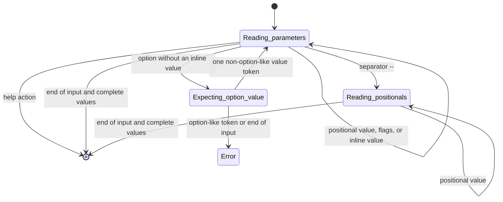

# Classes and usage

Declare a command's parameters, register the command with an application, and
read the parsed values in its handler. The application selects a command and
calls its handler only after parsing succeeds.

| Class | Responsibility |
|---|---|
| [CLI_COMMAND](../src/cli_command.e) | Declare a command and handle its input |
| [CLI_APPLICATION](../src/cli_application.e) | Register commands, select one, and execute it |
| [CLI_PARAMETER](../src/cli_parameter.e) | Describe a parameter's kind, type, and default |
| [CLI_COMMAND_INPUT](../src/cli_command_input.e) | Provide typed values to the handler |
| [CLI_PARSER](../src/cli_parser.e) | Parse tokens against parameter definitions |
| [CLI_HELP_COMMAND](../src/cli_help_command.e) | Expose generated help as an ordinary command |
| [CLI_STRING_ROUTINES](../src/cli_string_routines.e) | Validate parameter names and split strings explicitly |
| [CLI_FAILURE](../src/cli_failure.e) | Report a fatal diagnostic and terminate the process |

The source files define the feature signatures and contracts. The
[syntax guide](syntax.md) defines the command-line grammar.

## Commands and parameters

Inherit `CLI_COMMAND`, define `name` and `description`, declare parameters in
`interface`, and implement `handle`. A CLI program has one `CLI_APPLICATION`,
which owns command registration and execution. Commands belong to that
application; sharing them between applications is outside this usage model.
`CLI_APPLICATION` calls `interface` once per command instance on registration.
Do not call it directly. A direct repeat call executes the command's body again:
repeated declarations violate name uniqueness, and repeated alias assignment
violates the one-assignment contract. Command names must be unique.
`CLI_COMMAND.name` returns `READABLE_STRING_32`. Fixed names may be declared as
`name: STRING_32 = "greet"`. Names are declarative metadata: do not change their
value after registration, including during `interface`. This is a client
obligation rather than a restriction enforced by an immutable result type.
After the first `interface` call, the command adds an automatic help action unless
`help` is explicitly declared. Later declarations may replace automatic help or
claim its `h` alias before execution.
Public `add_*` and `set_short_name` calls may extend definitions before `run` or
`run_with_tokens`. Keep definitions unchanged during execution. Each run creates
a new parser, so the application may be run again. See the
[greet command](../examples/greet/src/greet_command.e) for a complete definition.

| Parameter | Declaration | Input | Value access |
|---|---|---|---|
| Positional argument | `add_string_argument` | `Alice` | `string_parameter` |
| Named option | `add_integer_option` | `--port 8080` | `integer_parameter` |
| Flag | `add_flag` | `--verbose` | `boolean_parameter` |
| Positional list | `add_string_list_argument` | `a.txt b.txt` | `string_list_parameter` |
| Repeated list option | `add_integer_list_option` | `--port 8080 --port 8081` | `integer_list_parameter` |

Arguments and options support strings, 32-bit integers, and lists of either type.
Use `add_optional_*` with an explicit default for optional parameters.
Use `set_short_name ("port", 'p')` to assign a one-letter alias.
The [parameter rules](syntax.md#parameter-definitions) cover declaration order,
unique names, and positional lists.
`CLI_PARAMETER.is_valid_name` checks parameter-name syntax. A command exposes
`has_parameter`, `has_positional_list`, and `has_optional_argument` to inspect
its current declarations. The [defaults rules](syntax.md#defaults-and-completion)
cover absent parameters and replacement of list defaults.

The handler receives `CLI_COMMAND_INPUT`. Its typed queries require a value of
the corresponding type. Use `has_parameter` or a type-specific `has_*_parameter`
query when checking for a value. String and list queries return copies, so
changing the returned data does not change the stored input.

## Choices

Scalar arguments and options can restrict values to a declared set. Declare them
inside a `CLI_COMMAND` descendant using separate choice procedures:

```eiffel
add_string_choice_option ("format", "Output format",
    {ARRAY [STRING_32]} <<"JSON", "yaml", "text">>, Case_insensitive)
add_optional_integer_choice_option ("level", "Compression level",
    {ARRAY [INTEGER]} <<0, 3, 6, 9>>, 6)
```

`Case_sensitive = True` and `Case_insensitive = False` are inherited Boolean
constants available inside every command. Pass one explicitly for string choices.
The handler uses ordinary `string_parameter` and `integer_parameter` queries.
For example, `--format=json` returns the declared spelling `JSON`.

| Procedure | Arguments after name and description |
|---|---|
| `add_integer_choice_argument`, `add_integer_choice_option` | `a_choices: ITERABLE [INTEGER]` |
| `add_optional_integer_choice_argument`, `add_optional_integer_choice_option` | `a_choices: ITERABLE [INTEGER]; a_default: INTEGER` |
| `add_string_choice_argument`, `add_string_choice_option` | `a_choices: ITERABLE [READABLE_STRING_32]; a_case_sensitive: BOOLEAN` |
| `add_optional_string_choice_argument`, `add_optional_string_choice_option` | `a_choices: ITERABLE [READABLE_STRING_32]; a_case_sensitive: BOOLEAN; a_default: READABLE_STRING_32` |

Sets must be nonempty and contain no duplicates under the selected comparison.
Defaults must match a declared value; string defaults use the same comparison and
are stored in declared spelling. These are declaration preconditions, separate
from errors in user input. Empty strings are valid choices. Choice definitions
snapshot the collection and its strings, preserving declaration order. Changes
to the caller's data do not affect parsing or help.

`are_valid_integer_choices`, `are_valid_string_choices`, `has_integer_choice`, and
`has_string_choice` allow callers to check these obligations before declaring a
parameter. These queries and comparison constants come from `CLI_CHOICE_ROUTINES`,
inherited by both `CLI_COMMAND` and `CLI_PARAMETER`.

Direct parser users create definitions with the corresponding
`CLI_PARAMETER.make_*_choice_*` procedures using the same argument order.
`has_choices` identifies a restricted parameter; `choices_text` returns a fresh
ordered display. String matching uses the common ELKS
`READABLE_STRING_32.is_case_insensitive_equal` operation in insensitive mode.
This comparison is independent of system locale and does not perform Unicode
normalization or full case folding (for example, `ß` and `ss` remain distinct).
See [choice syntax](syntax.md#choices) for token handling and errors.

## Value validators

A parameter can have one predicate for its complete typed value. Set it after
adding the parameter, inside `interface`:

```eiffel
add_integer_option ("count", "Number of repetitions")
set_integer_validator ("count", agent is_positive, "Must be greater than zero")
```

The command supplies a query such as:

```eiffel
is_positive (a_value: INTEGER): BOOLEAN
    do
        Result := a_value > 0
    end
```

| Setter | Predicate type |
|---|---|
| `set_integer_validator` | `FUNCTION [TUPLE [INTEGER], BOOLEAN]` |
| `set_string_validator` | `FUNCTION [TUPLE [READABLE_STRING_32], BOOLEAN]` |
| `set_integer_list_validator` | `FUNCTION [TUPLE [ARRAYED_LIST [INTEGER]], BOOLEAN]` |
| `set_string_list_validator` | `FUNCTION [TUPLE [ARRAYED_LIST [STRING_32]], BOOLEAN]` |

Each setter takes the parameter name, predicate, and nonempty failure message.
Scalar setters accept only scalar parameters; list setters accept only lists.
A list predicate checks the entire collection, including its size, order, or
individual elements as needed. There is no separate element validator.
Flags and help actions do not support validators. A second assignment is invalid.

Predicates must accept every value of their input type, have no side effects,
and return a stable result independent of mutable external state. They are
retained as agents. Strings and lists passed during validation are independent
copies, including copies of string-list elements. Failure messages are snapshotted.

Defaults must satisfy the proposed predicate before installation; this is a
setter precondition. `can_set_*_validator (name, predicate)` queries expose these
obligations. Direct parser clients use the same setters and queries on
`CLI_PARAMETER`, omitting the name argument. `has_validator`,
`is_valid_*_value`, and `validator_message` expose the configured rule.

After parsing, choices, required-value checks, and defaults, predicates run in
declaration order until the first failure. String choices reach the predicate in
canonical declared spelling. A rejected value reports
`Invalid value for NAME: MESSAGE`; the handler is not called. Help bypasses this
final validation. Use handler validation for relationships between parameters.

## Applications

`CLI_APPLICATION.make` takes the application name and description. Register each
command with `add_command`, then call `run`.
`is_valid_command_name` checks command-name syntax, including the empty default
name; `has_command` checks whether a name is already registered.
`run` reads process arguments through `ARGUMENTS_32`. Use `run_with_tokens` to provide tokens directly, excluding the
executable name. See the [text application](../examples/text/src/text_application.e).

A command with `name = ""` accepts input without a command prefix. An application
with only that command behaves as a single-command utility:

```eiffel
create application.make_single_command ("greet", create {GREET_COMMAND})
application.run
```

`make_single_command` requires a command whose name is empty and uses its
description as the application description. The complete entry point
is in [greet_application.e](../examples/greet/src/greet_application.e).

Command names may also contain several words. An empty command can coexist with
named commands to provide parameters for root invocations. See
[command selection](syntax.md#command-selection) for matching and precedence,
and the [arc example](../examples/arc/README.md) for declarations and invocations.

## Help

Help text is generated from registered parameter definitions:

| Query | Result |
|---|---|
| `application.help` | Application overview with the registered commands |
| `application.command_help ("pack")` | Parameter help for a named command |
| `application.command_help ("")` | Parameter help for the default command |
| `command.help (invocation)` | Parameter help, including initialized automatic help, using an explicit invocation string |

`command_help` requires the requested command to be registered.
`CLI_HELP_COMMAND` without command words prints the application overview, even
when a default command exists. With command words it prints that command's help.

`application.show_help (name)` prints help for a registered command, including
the empty default command. With an empty name and no default command, it prints
the application overview. Other unknown names report an error.

Applications provide `--help` and, when free, `-h` for every command that does
not declare a parameter named `help`. These flags show detailed command help,
including parameter types, defaults, aliases, and the automatic help spellings.
They bypass missing required parameters and do not call the handler. With no
selected command, a standalone `--help` or `-h` shows the application overview.
See [automatic help](syntax.md#automatic-help) for precedence and token rules.

To also expose help as a command, register `CLI_HELP_COMMAND`:

```eiffel
application.add_command (create {CLI_HELP_COMMAND}.make (application))
```

This adds a command named `help`, not a `--help` flag. It accepts command words,
such as `tool help remote add`. The
[text application](../examples/text/src/text_application.e) demonstrates registration.
An explicitly declared flag named `help` follows the same parsing and
required-parameter rules as any other flag.

## Errors

`run` and `run_with_tokens` report invalid commands or arguments to standard error
and exit with code `2`. The handler is not called when parsing fails.

For validation inside a handler, call the inherited `fail` feature:

```eiffel
count := a_input.integer_parameter ("count")
if count < 0 then
    fail ("Count must be zero or greater.", Invalid_call)
end
```

See [repeat_command.e](../examples/text/src/repeat_command.e) for the complete handler.
`CLI_COMMAND` defines `Command_error = 1` for execution failures and
`Invalid_call = 2` for invalid input. `fail` requires a nonzero exit code and
terminates the process immediately. It does not raise an exception, run `rescue`,
or undo earlier work.

## Direct parsing

Use `CLI_PARSER` when command selection and process handling are managed elsewhere.
Pass an iterable of `CLI_PARAMETER` definitions to `make` and a
`READABLE_INDEXABLE [READABLE_STRING_32]` of input tokens to `parse`:

```eiffel
create parser.make (parameters)
parser.parse (tokens)
if parser.is_successful then
    values := parser.values
elseif parser.has_error then
    message := parser.error_message
else
    -- A help action was requested; display the caller's help text.
end
```

Parameter and application metadata use immutable strings; command names,
descriptions, and name-query arguments use readable strings. String defaults, list-default elements,
input tokens, and diagnostics also accept readable strings, including immutable
strings. List-default queries return copies,
including copies of string elements.

Tokens exclude the executable and command prefix. Definitions must have unique names and short aliases, with required arguments
before optional arguments and a positional list last. `are_valid_definitions`
checks these requirements; `make` requires them. Definitions must remain
unchanged until parsing finishes. The parser reads tokens without retaining or
changing them. Each parser accepts one `parse` call; create another parser for
another input.

The parser performs no I/O. A definition created with `CLI_PARAMETER.make_help`
has `Help_action`; ordinary definitions have `Store_action`. All definitions use
the same parser constructor. When a help action is recognized, `help_requested`
is True and neither `is_successful` nor `has_error` is True. The caller displays
help without reading `values`. A help request stops token processing and bypasses
required-parameter checks.

`values` is available only after a complete successful parse. On failure,
`error_message` returns the diagnostic. There is no separately
exposed partial result or required-parameter validation call.

The main loop handles one input token per iteration. Its states are explicit;
short groups use an inner loop over letters:



Any state can fail on invalid input. Completeness checks and defaults are part of
the same `parse` call. See [CLI_PARSER](../src/cli_parser.e) for the loop and transitions.

## Explicit splitting

`CLI_STRING_ROUTINES.split` splits a parsed string on a chosen character:

```eiffel
create routines
parts := routines.split ("a,,b", ',')
```

The result contains `"a"`, `""`, and `"b"`. Whitespace and empty parts are preserved;
empty input produces one empty part. Quotes and escape characters have no special
meaning. The helper returns strings and does not perform numeric conversion.
Use it in a handler when that command wants delimited values. It does not change
the parser's [list-option syntax](syntax.md#named-options).
